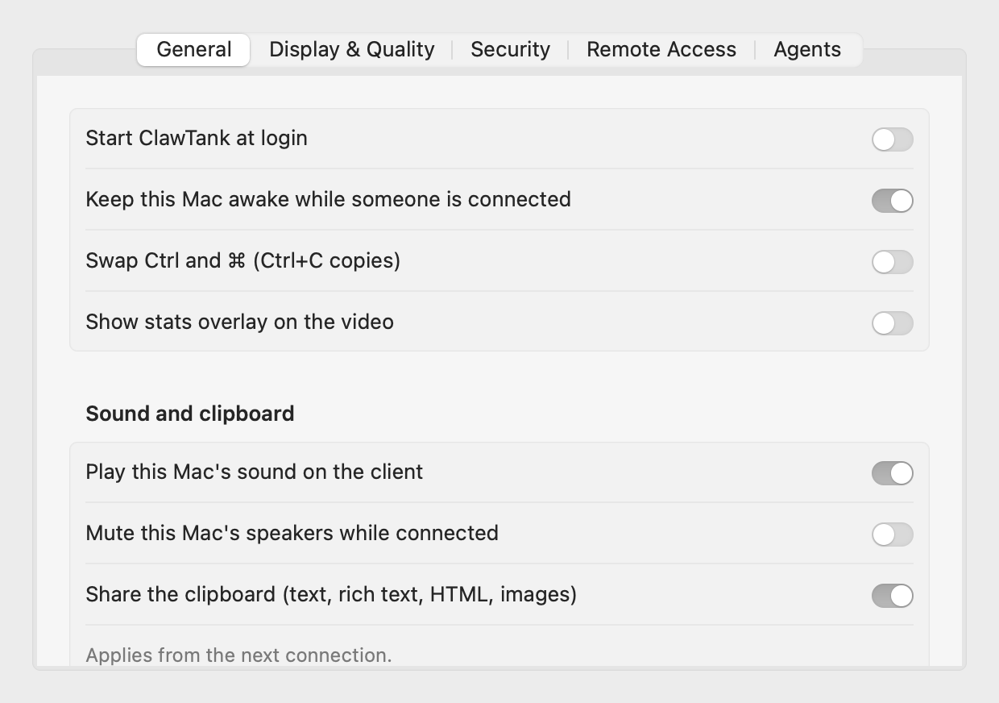
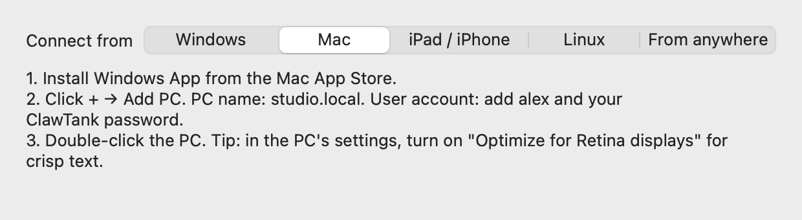

# ClawTank

**RDP into your Mac. Open source, hardware-accelerated, no cloud.**

[](https://github.com/HMAKT99/ClawTank/actions/workflows/ci.yml)
[](https://github.com/HMAKT99/ClawTank/releases)
[](LICENSE)


[Install](#install) · [Connect](#connect) · [FAQ](#faq) · [Troubleshooting](#troubleshooting) · [Documentation](docs/README.md) · [Help test the beta](#help-test-the-beta)

ClawTank is a native RDP server for macOS. Connect from any standard Remote Desktop client to your Mac and get a smooth, full desktop: Windows App on Windows, Mac, iPad and iPhone, Microsoft's RDP app on Android, the built-in `mstsc` on Windows, or FreeRDP on Linux. It works especially well with a headless Mac mini.

<!-- Demo GIF goes here: docs/media/demo.gif (a client connecting, moving windows, resizing). -->

<p align="center">
  
  
</p>

> **Status: 0.9 beta.** Every feature below is covered by automated tests, live measurements and a FreeRDP interop test on each commit. Hands-on testing with Microsoft's clients (Windows App, `mstsc`), headless Mac minis and real-world networks is under way: please [help test](#help-test-the-beta) or [report issues](https://github.com/HMAKT99/ClawTank/issues).

## Features

- **Fast:** H.264 video encoded by the Mac's media engine and sent over the RDP graphics pipeline. About 60 fps at under 10% CPU on Apple silicon.
- **Fits your screen:** the desktop resizes live to the client's window. Retina virtual displays give crisp text, and a headless Mac needs no dummy HDMI plug.
- **Feels local:**
  - keyboard and mouse, including scroll, middle and back/forward buttons
  - cursor shapes drawn on the client
  - system audio, two-way clipboard (text, rich text, images)
  - copy and paste of files and folders
- **Secure by default:**
  - TLS with Network Level Authentication and its own password (never your macOS password)
  - local-network only, lockout after failed logins, an audit log
- **Reach it from anywhere** with Tailscale: no port forwarding, and nothing exposed to the internet ([guide](docs/remote-access.md)).
- **Agent API and MCP server:** let AI agents on the Mac take screenshots and drive it, with per-agent tokens, an audit log and a visible Stop button ([guide](docs/agent-api.md)).
- **Free and open source** under Apache-2.0, including for companies. No account, no telemetry, no cloud.

## How it compares

| | **ClawTank** | macOS Screen Sharing | Chrome Remote Desktop |
|---|---|---|---|
| Protocol | RDP | VNC-based (Apple extensions) | Proprietary, through Google |
| Connect from Windows with built-in tools | ✅ `mstsc` / Windows App | ❌ needs a VNC client | ❌ needs Chrome |
| iPad / iPhone / Android | ✅ Windows App / Microsoft RDP apps | Third-party VNC apps | ✅ Chrome Remote Desktop app |
| Account needed | No | No | Google account |
| Traffic path | Direct (LAN or your own Tailscale) | Direct | Set up through Google's servers; relayed by Google when a direct path fails |
| Hardware video encoding | ✅ H.264 | In High Performance mode (Mac to Mac, Apple silicon) | — |
| Desktop resizes to the client window | ✅ | — | — |
| Price / license | Free, Apache-2.0 | Included with macOS | Free, closed source |

Based on each product's public documentation. Corrections are welcome. "—" means we didn't verify it.

## Install

**Requirements:** macOS 14 Sonoma or later, on Apple silicon. Intel Macs: build from source (untested).

1. Download `ClawTank-<version>-arm64.dmg` from [Releases](https://github.com/HMAKT99/ClawTank/releases). Optionally check it against `SHA256SUMS`:
   ```sh
   shasum -a 256 ~/Downloads/ClawTank-*.dmg
   ```
2. Open the DMG and drag **ClawTank** to **Applications**.
3. **First launch (this beta isn't notarized yet):**
   1. Open ClawTank. macOS says it can't verify the developer.
   2. Click **Done**, then go to **System Settings → Privacy & Security**.
   3. Scroll down to the message about ClawTank and click **Open Anyway**, then confirm with your password or Touch ID.

   You only do this once. If you prefer Terminal: `xattr -dr com.apple.quarantine /Applications/ClawTank.app`. Notarized, Developer ID-signed builds will open normally; see [docs/releasing.md](docs/releasing.md).
4. ClawTank lives in the **menu bar** (a display icon). The setup window walks you through:
   - **Screen Recording:** so the client can see your screen.
   - **Accessibility:** so the client's keyboard and mouse can control the Mac.
   - **A ClawTank password:** this is what you'll type in the RDP client. It isn't your Mac password.

The setup window then shows the address, username and certificate fingerprint to connect with. You can reopen it any time from **menu → Setup Guide…**.

## Connect

Use the address shown in the ClawTank menu (**Copy Address**), your ClawTank username (shown in setup) and your ClawTank password. Your client and the Mac must be on the same network, or both on Tailscale (see below).

<details open><summary><b>Windows (Remote Desktop Connection)</b></summary>

1. Press **Win+R**, type `mstsc`, press Enter.
2. **Computer:** the Mac's address. Click **Show Options** and enter the **User name**.
3. Click **Connect** and enter your ClawTank password.
4. Windows warns about the certificate. Check that the fingerprint matches the one in ClawTank's Setup Guide, then accept it. Tick "Don't ask me again" so you aren't asked next time.
</details>

<details><summary><b>Mac (Windows App)</b></summary>

1. Install **Windows App** from the Mac App Store.
2. Click **+ → Add PC**. **PC name:** the Mac's address. **User account:** add your ClawTank username and password.
3. Double-click the PC. Tip: in the PC's settings, turn on **Optimize for Retina displays** for crisp text.
</details>

<details><summary><b>iPad / iPhone / Android</b></summary>

1. Install **Windows App** from the App Store (on Android, Microsoft's Remote Desktop / Windows App from Google Play).
2. Tap **+ → Add PC**. Enter the Mac's address, and your ClawTank username and password.
3. Tap the PC to connect.
</details>

<details><summary><b>Linux (FreeRDP / Remmina)</b></summary>

```sh
xfreerdp3 /v:<address> /u:<username> /dynamic-resolution /gfx:avc420
```
Or add an RDP connection in Remmina with the same address and username.
</details>

**From outside your home or office:** install [Tailscale](https://tailscale.com/download) on the Mac and on your device, and sign in to the same account. Then connect to the name shown in **ClawTank → Settings → Remote Access**. Don't forward port 3389 on your router. See [docs/remote-access.md](docs/remote-access.md), which also covers Wake-on-LAN.

## FAQ

**Is it safe to run?**
Connections are encrypted with TLS and require NLA, so the password is checked before any screen is shown. By default only local-network and Tailscale addresses can connect. 5 failed logins in 5 minutes block that address for 5 minutes. Every attempt is recorded in **menu → Connection Log…**. The password is stored in your Keychain, or in a 0600 file for ad-hoc builds.

**Why does it need Screen Recording and Accessibility?**
Screen Recording lets ClawTank capture the screen to send it. Accessibility lets it turn the client's keyboard and mouse into real input. Without Accessibility, you can watch but not control. ClawTank never records to disk.

**Why a separate password instead of my macOS account?**
So a leaked RDP password can't unlock your Mac, your Keychain or `sudo`. Change it in **Settings → Security**.

**Can I connect while the Mac is locked or at the login window?**
macOS doesn't let apps capture a locked screen: clients see only the wallpaper until someone unlocks the Mac at the keyboard. On an always-on Mac mini you can turn on automatic login (not available with FileVault), so the desktop is ready after a restart. Weigh that against who can physically reach the Mac. The ClawTank menu shows when the Mac is locked.

**Several people at once? Separate macOS users?**
One RDP session at a time, showing the logged-in user's desktop. Separate sessions per macOS account aren't possible with public macOS APIs.

**Why isn't it on the Mac App Store?**
The APIs ClawTank needs (input injection, virtual displays) aren't allowed in sandboxed App Store apps.

**macOS asks for permissions again after I update.**
Unsigned (ad-hoc) builds get a new code identity every release, so macOS treats each update as a new app. Re-enable ClawTank under **Privacy & Security → Screen Recording / Accessibility** (remove the old entry first if it's there). Developer ID-signed builds will keep their permissions.

**Does it phone home?**
No. ClawTank makes no network connections of its own. It only accepts incoming RDP connections, plus optional local Agent API calls on 127.0.0.1.

## Troubleshooting

| Problem | Try |
|---|---|
| Client can't find the Mac / times out | Check you're on the same network and using the address from **Copy Address**. If macOS asked "Accept incoming network connections?" for ClawTank, choose **Allow** (System Settings → Network → Firewall → Options). Check the menu says "Ready". |
| "Your credentials did not work" | Use your **ClawTank** username and password, not your Mac account. Copy them from the menu or the Setup Guide. After 5 failures, wait 5 minutes. |
| Connection refused from another network | It's LAN-only by design. Use Tailscale ([guide](docs/remote-access.md)). |
| Certificate warning every time | Accept it once with "Don't ask me again" after checking the fingerprint in the Setup Guide. |
| You see only the wallpaper | The Mac is locked. Unlock it at the keyboard. |
| You can see but not control | Grant **Accessibility** to ClawTank (System Settings → Privacy & Security → Accessibility), then reconnect. |
| Black screen | Grant **Screen Recording**, then quit and reopen ClawTank. |
| No sound | Check **Settings → General → Play this Mac's sound on the client**, and turn on audio in your client's settings. |
| Ctrl+C doesn't copy (from Windows) | Turn on **Settings → General → Swap Ctrl and ⌘**. |
| Choppy over Wi-Fi | Lower **Settings → Display & Quality**, or use Ethernet on the Mac. The menu shows live fps and round-trip time. |
| Anything else | **Menu → Export Diagnostics…** creates a zip with no secrets in it. Attach it to an [issue](https://github.com/HMAKT99/ClawTank/issues). |

## Known limitations

- One monitor per session: a multi-monitor client gets one resizable desktop. No AVC444 (full-colour 4:4:4) yet; Retina sessions give crisp text instead.
- Not notarized yet, so you need the one-time "Open Anyway" step. Apple silicon builds only.
- No automatic updates yet: watch [Releases](https://github.com/HMAKT99/ClawTank/releases) on GitHub.
- See [CHANGELOG.md](CHANGELOG.md) and [docs/testing.md](docs/testing.md) for what's been verified.

## Help test the beta

We're looking for people to try 0.9 on real setups: Windows and Mac clients, iPads, headless Mac minis, Wi-Fi and Tailscale. The [beta testing guide](docs/beta-testing.md) is a short script, about 5–15 minutes per section. Report each result, including passes, with the [Beta test report](https://github.com/HMAKT99/ClawTank/issues/new?template=beta_report.yml) form.

## Documentation

- [Remote access with Tailscale](docs/remote-access.md)
- [Agent API and MCP server](docs/agent-api.md)
- [Architecture](docs/architecture.md) and [design decisions](docs/decisions.md)
- [Testing record](docs/testing.md) and [releasing](docs/releasing.md)
- All docs: [docs/README.md](docs/README.md)

## Building from source

Requirements: macOS 14+, Xcode 16+, Rust (stable, via rustup), `brew install xcodegen swiftlint`.

```sh
make build        # Rust core + ClawTank.app (app/build/Build/Products/Release/)
make dev-signing  # one-time: a local signing identity so permissions survive rebuilds
make test         # cargo test + XCTest
make lint         # clippy -D warnings, rustfmt, swiftlint
make release      # versioned DMG + SHA256SUMS + release notes in dist/
```

To work in Xcode, run `make core project`, then open `app/ClawTank.xcodeproj`. Architecture: [docs/architecture.md](docs/architecture.md). Design decisions: [docs/decisions.md](docs/decisions.md).

## Contributing

Contributions are welcome. See [CONTRIBUTING.md](CONTRIBUTING.md) for setup and conventions, including the clean-room rule. Please follow the [Code of Conduct](CODE_OF_CONDUCT.md). For help, see [SUPPORT.md](SUPPORT.md). To report a vulnerability privately, see [SECURITY.md](SECURITY.md).

## License

Apache-2.0. See [LICENSE](LICENSE) and [THIRD_PARTY_NOTICES.md](THIRD_PARTY_NOTICES.md). ClawTank is built on [IronRDP](https://github.com/Devolutions/IronRDP).
