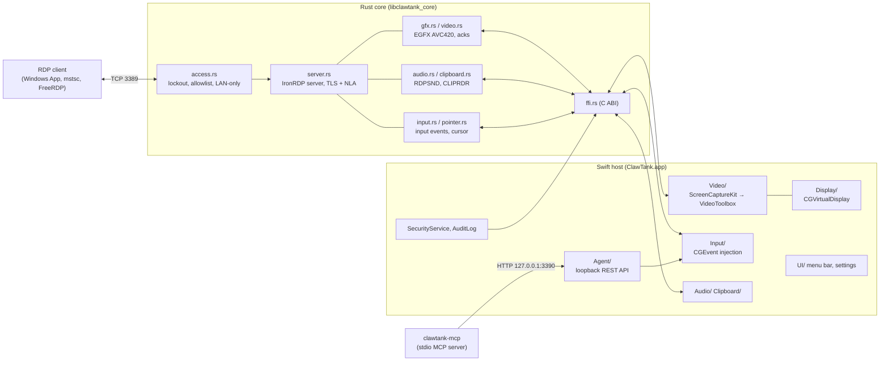

# Architecture

ClawTank has two halves joined by a small C ABI:

- **`libclawtank_core.a` (Rust):** the RDP protocol, built on [IronRDP](https://github.com/Devolutions/IronRDP) 0.13. It covers TLS, NLA, the graphics pipeline, virtual channels and the access policy. It never calls macOS APIs.
- **`ClawTank.app` (Swift, SwiftUI menu-bar app):** everything specific to macOS: capture, encoding, input injection, virtual displays, the Keychain and the UI. It never parses RDP.

This split is ADR-001 and ADR-002 in [decisions.md](decisions.md). The boundary lives in `core/clawtank-core/src/ffi.rs`, and `core/include/clawtank_core.h` is generated from it by cbindgen. On the Swift side the boundary is `app/ClawTank/CoreBridge.swift`.

## Data paths

**Video.**
1. `ScreenCapture.swift` captures one display with ScreenCaptureKit. Frames are IOSurface-backed and arrive only when the screen changes.
2. `H264Encoder.swift` encodes them with VideoToolbox: low-latency H.264, 4:2:0.
3. The Annex-B access unit goes through the C ABI as a pointer and length.
4. `video.rs` sends it as an EGFX AVC420 frame.

Backpressure is applied before encoding, in `VideoSession.swift`: if the core wouldn't send a frame, the frame isn't encoded. `AdaptiveBitrate.swift` tunes the bit rate once a second, using the core's frame-acknowledgement timing.

**Display.** `DisplayService.swift` picks the source from the Display setting:
- **Virtual:** a virtual display (`CGVirtualDisplay`, a private API isolated behind a provider: ADR-004) sized to the client's window.
- **Physical:** the Mac's own screen, scaled to fit.
- **Automatic:** virtual when the Mac is headless, physical otherwise.

Live resize arrives through the Display Control channel (`resize` in the core) and either resizes the virtual display in place or recreates it.

**Input.** The client's scancodes, Unicode and mouse events are decoded in `input.rs` and delivered to `InputPipeline.swift`. `ScancodeMap` and `CoordinateMapper` translate them, and `InputInjector` posts CGEvents (this needs the Accessibility permission). Cursor shape changes travel the other way: `CursorPublisher.swift` → `pointer.rs`, which draws the cursor on the client.

**Audio.** `AudioCapture.swift` runs a separate ScreenCaptureKit stream that captures audio only, so video restarts don't interrupt it. `PCMConverter` turns it into 48 kHz 16-bit stereo, and `audio.rs` sends it over RDPSND. Digital silence is skipped.

**Clipboard and files.** `ClipboardService.swift` keeps NSPasteboard in sync with CLIPRDR (`clipboard.rs`). It handles text, RTF, HTML and images, converting with `ClipboardFormats.swift`. `FileTransfer.swift` serves file contents on demand in byte ranges, and saves incoming files to `~/Downloads/ClawTank`.

**Agent API (optional, off by default).** `HTTPServer.swift` listens on `127.0.0.1:3390` only. `AgentAPI.swift` checks per-agent bearer tokens (the app stores only their hashes) and routes each request to `AgentHost.swift`, which takes screenshots, injects input and opens apps. `clawtank-mcp` (Rust, in `core/clawtank-mcp`) wraps that REST API as an MCP server over stdio. A person using the Mac over RDP always takes priority: agent input is refused for 3 s after their last input. See [agent-api.md](agent-api.md).

## Security model

| Layer | Where | What |
|---|---|---|
| Before any handshake | `access.rs` | Lockout (5 failures in 5 min), optional allowlist, LAN-only (private, link-local, CGNAT/Tailscale and ULA ranges) |
| Transport | `tls.rs`, `server.rs` | TLS always, with a stable self-signed RSA-2048 identity verified by its SHA-256 fingerprint |
| Authentication | IronRDP CredSSP | NLA required, with a dedicated ClawTank password, not the macOS one (ADR-003) |
| Secrets | `SecurityService.swift` | Keychain for signed builds; an owner-only 0600 file for ad-hoc builds (ADR-013) |
| Accountability | `AuditLog.swift` | JSON-lines log of every connection, failure and agent action, rotated, viewable in the app |

ClawTank makes no outgoing network connections and sends no telemetry.

## Threading

- The core runs IronRDP on its own small tokio runtime and thread (`server.rs`). Events reach Swift on that thread and are hopped to the main actor where needed.
- Capture and encoding run on their own dispatch queues.
- The app is built with Swift 6 strict concurrency.

## Repository map

| Path | Contents |
|---|---|
| `core/clawtank-core/` | Rust protocol core: `src/` (modules above), `tests/` (end-to-end tests with IronRDP's client), `examples/` (`probe`, `testserver`, `files_demo`) |
| `core/clawtank-mcp/` | The MCP server for agents |
| `core/vendor/ironrdp-server/` | IronRDP server with small patches; see [THIRD_PARTY_NOTICES.md](../THIRD_PARTY_NOTICES.md) |
| `app/` | XcodeGen project (`project.yml`), the Swift app (`ClawTank/`) and XCTest (`ClawTankTests/`) |
| `scripts/` | Signing, DMG packaging, release |
| `tests/` | FreeRDP interop smoke test (run in CI on Linux) |
| `spikes/` | Phase 0 experiments (virtual display) |
| `docs/` | This documentation, ADRs, research, phase plans |
